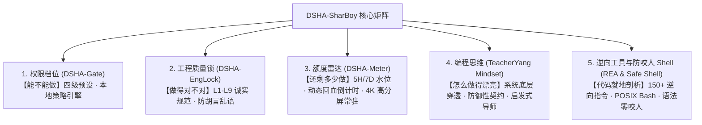

# DSHA-SharBoy — Systems Engineering & Governance Suite (for Antigravity & ChatGPT)

> 把 **DeepSeek Harness** 权限体系、工程质量锁、实时额度雷达与**杨老师系统级编程思维**全面融合，打造适用于 **Antigravity** 与 **ChatGPT** 双平台的通用高阶系统工程治理套件。  
> **v2.2.0** ｜ Windows ｜ 依赖 Python 3.10+ ｜ 无外部网络依赖 ｜ 纯本地运行

---

## 一、 体系全貌 (The Five Pillars)



| 模块 | 核心职责 | 机制与技术实现 |
|---|---|---|
| **DSHA-Gate** | **能不能做** | 四级具名档位（`read-only` / `workspace-write` / `danger-full-access` / `auto`），结合 `gate.py` 本地策略引擎与 Anty 原生开关联动。 |
| **DSHA-EngLock** | **做得对不对** | L1 出处 / L2 样本 / L3 撤回 / L4 三件套 / L5 报告头 / L6 措辞 / L7 断拍 / L8 外部审查 + **L9 语言规范锁**（基于词表 `lexicon.json` 杜绝模型胡言乱语与虚假承诺）。 |
| **DSHA-Meter** | **还剩多少做** | 解析 Antigravity 本地 JSONL 事务日志，实时统计 5H 滚动窗口与 7D 周配额水位；提供首笔回血与完全回满倒计时预测；DWM 物理级 DPI 缩放渲染。 |
| **TeacherYang Mindset** | **怎么做得漂亮** | 蒸馏自 14 门系统级课件的五大支柱（系统底层穿透律、防御契约、并发选型与锁纪律、高内聚 AOP 切面、量化实证）；配套五步启发教学范式。 |
| **REA & Safe Shell** | **代码就地剖析与防咬人** | 引入 `morluto/rea` 150+ 逆向指令就地解析 JS/ASAR/PE/APK；配置 GNU Bash 全局环境与零圆括号批处理，杜绝 Windows PowerShell 语法咬人。 |

---

## 二、 快速开始 (Quick Start)

### 1. 安装与验证
在 PowerShell 终端运行：
```powershell
powershell -ExecutionPolicy Bypass -File .\install.ps1 -WhatIfOnly   # 1) 只读预演（检查环境）
powershell -ExecutionPolicy Bypass -File .\install.ps1               # 2) 一键安装（自动探测 Python 与包装器）
powershell -ExecutionPolicy Bypass -File .\verify.ps1                # 3) 完整体检（期望 29 项通过，0 FAIL）
```

### 2. 权限切换与 UI 面板
在 Antigravity 会话中：
- 输入 `/DSHA` 查看或切换当前权限档位；
- 输入 `/DSHA 面板` 在对话中内联唤起交互式卡片选择器；
- 命令行直接查询：
  ```powershell
  powershell -ExecutionPolicy Bypass -File "$env:USERPROFILE\.gemini\config\agy-tier.ps1" -Status
  ```

### 3. 额度雷达悬浮窗控制
常驻桌面或 Anty 前台：
```powershell
powershell -ExecutionPolicy Bypass -File "$env:USERPROFILE\.gemini\config\agy-meter.ps1" -Start    # 启动悬浮窗
powershell -ExecutionPolicy Bypass -File "$env:USERPROFILE\.gemini\config\agy-meter.ps1" -Status   # 终端快速查看遥测数据
powershell -ExecutionPolicy Bypass -File "$env:USERPROFILE\.gemini\config\agy-meter.ps1" -Stop    # 停止悬浮窗
```

### 4. 杨老师工程导师模式与合规安全 Shell (Pwsh 7 & REA)
在会话中参考 `skills/DSHA/teacher-yang.md` 或直接要求 Anty：
> *“请用 TeacherYang 风格为这段代码做系统级底层审查与防御性重构。”*  
Anty 将遵循“痛点启发 -> 本质穿透 -> 步骤拆解 -> 避坑防线 -> 运行实证”五步闭环交付。

针对任何模型与终端执行，DSHA 提供了免受括号撕裂的专用 Shell：
```cmd
pwsh -NoProfile -Command "..."      # 专用 PowerShell 7 独立运行时（无原生 PS 5.1 别名与括号缺陷）
dsha-pwsh -Command "..."            # 加固 PowerShell 7 启动器（自动 Bypass 且 -NoProfile）
dsha-sh -c "..."                    # 防咬人 GNU Bash 5.3 启动器
rea <command>                       # 就地调用 REA 逆向工程套件
```

### 5. 分享给本机的 ChatGPT 客户端 (SharBoy 专属导师)
DSHA-SharBoy 提供了直接适用于本机 **ChatGPT Windows 客户端** 的完整扩展：
1. **自定义指令注入 (Custom Instructions)**：
   - 打开 ChatGPT 客户端，进入 **Settings -> Custom Instructions**；
   - 复制 `chatgpt/SHARBOY_PROMPT.md`（或桌面上的 `DSHA-SharBoy_ChatGPT提示词.txt`）中的指令粘贴保存；
   - ChatGPT 客户端即刻化身 **SharBoy**，获得杨老师 13 章底层穿透思维与 L1-L9 工程锁守护。
2. **MCP (Model Context Protocol) 工具接入**：
   - 使用 `chatgpt/mcp_config.json` 将 `rea mcp` 挂载为本地逆向与代码分析工具服务器。

---

## 三、 核心架构与代码布局

```
DSHA/
├── bin/
│   ├── pwsh.cmd                # DSHA 专用 PowerShell 7 零括号启动器
│   ├── dsha-pwsh.cmd           # DSHA 加固 PowerShell 7 启动器
│   ├── dsha-sh.cmd             # 防咬人 GNU Bash 启动器（规避 Win 括号咬人）
│   ├── bash.cmd / sh.cmd       # GNU Bash 便携代理
│   ├── rea.cmd                 # REA 逆向工具集全局调用器
│   ├── agy-tier.ps1            # 权限档位切换器（唯一事实源）
│   ├── agy-meter.ps1           # 额度悬浮窗控制器（启动/停止/状态）
│   ├── agy-audit.ps1           # 门禁决策审计与统计
│   └── agy-verify.ps1          # 自动化环境体检
├── docs/
│   ├── TEACHER_YANG_DISTILLATION.md # PPT 原语蒸馏与教学认知脚手架报告
│   ├── TEACHER_YANG_MINDSET.md      # 系统级编程思维五大支柱架构规范
│   ├── ENGINEERING_LOCK.md          # L1-L8 工程锁技术规范
│   ├── LANGUAGE_NORM.md             # L9 语言规范锁触发与补偿机制
│   └── 防胡言乱语效果评估.md        # 真实语料过锁测试报告
├── plugins/
│   ├── dsh-permissions/        # 权限门禁本体（gate.py, lexicon.json, AGENTS.md）
│   ├── dsha-englock/           # 独立工程锁插件（与切档解耦，hooks 独立）
│   └── dsha-meter/             # 实时额度监视器本体（meter.py, 高分屏渲染）
├── scripts/
│   └── fetch-pwsh.ps1          # 专用 Pwsh 运行时极速自举拉取器
├── skills/
│   ├── DSHA/                   # DSHA 核心技能套件
│   │   ├── SKILL.md            # Anty 技能定义入口
│   │   ├── widget.html         # 内联 UI 权限卡片面板
│   │   ├── teacher-yang.md     # 杨老师工程辅助快速指南
│   │   └── reference.md        # 四档警告与运维陷阱参考
│   └── reverse-engineer-anything/ # REA 逆向套件与本地驱动器
├── install.ps1                 # 幂等安装器（带时间戳备份与一键卸载）
├── verify.ps1                  # 39 项自动化体检套件（全绿）
├── CHANGELOG.md                # 版本演进历程
├── README.md                   # 项目说明
└── VERSION                     # 当前版本号 (2.0.0)
```

---

## 四、 设计哲学与工程规范

1. **Fail-Open 韧性原则**：所有门禁与校验器自身异常时一律放行，永远不把辅件故障转嫁给主宿主；
2. **数据与逻辑解耦**：L9 过滤词库完全配置化（`lexicon.json`），改词表即改行为；
3. **提示词纯 ASCII 隔离**：`AGENTS.md` 注入文件保持严格 0 个非 ASCII 字节，彻底杜绝多环境编码冲突；
4. **零隐私泄漏与绝对脱敏**：杜绝写死个人绝对路径，全线采用 `$env:USERPROFILE` 动态解析与自适应探测；
5. **闭环三件套交付 (L4)**：所有工程方案必带“测试报告 + 复现指令 + 回滚/退出方式”。

---

## 五、 许可证与致谢

- 本项目基于 **MIT License** 开源。
- 灵感致敬 **DeepSeek Harness** 开源项目与 **杨老师代码体系**。
