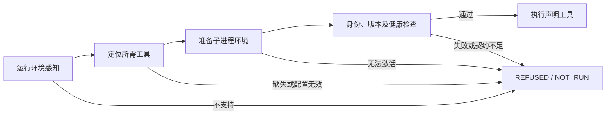

# EnvFeel：先感知，再执行

EnvFeel把环境发现与执行门禁连接起来。依赖由当前任务声明，不能因为系统缺少无关工具而拒绝整个任务，也不能把盘点清单中的“存在”直接当作执行许可。



## 门禁契约

感知使用运行时报告的OS、架构和进程位数，不用OS环境变量冒充实际平台。当前规则覆盖Windows、Linux、Darwin与已列出的x86/x86_64/arm64名称；未知组合拒绝。真实跨平台运行仍需分别实测，规则存在不代表这些平台已验收。Python引导运行时本身必须已可执行；本模块不能在完全无法启动Python的OS上自举，也不是硬件身份认证。

定位优先使用明确参数，再进程环境、指定环境文件和PATH/SDK位置。无效覆盖不得回退。所需路径固定为绝对路径，原始位置只写私有清单。

激活仅构造当前调用的子进程环境：设置选中工具对应DSHA_*、前置工具目录至PATH，必要时设置JAVA_HOME与UTF-8输出。发现、自检及执行使用同一份环境；不改系统或用户环境、不修改注册表、不下载安装工具。环境文件不会执行或插值。

执行前检查工具品牌、版本及已定义健康样本。Python/Node执行、Rust/Java编译运行、MSVC对象编译、PowerShell/Bash/Sh标记输出分别有自有样本。其他具备品牌版本契约的条目只证明该探测可运行，不证明项目、网络、服务端或账号已可用。仅有数字版本而没有充分身份契约的条目返回INSUFFICIENT_CONTRACT；盘点可记录，门禁不能据此放行。

每次execute重新检查。READY只表示本轮声明条件通过，不是可重放的通行证；检查失败时任务为NOT_RUN，退出126。任务自身失败则TASK_FAILED，不能伪报环境检查失败或任务成功。超时不是外部后代或远程操作已停止的证明。

## 使用

```text
python <skill-dir>/scripts/dsha.py envfeel --require python
python <skill-dir>/scripts/dsha.py envfeel --require node --binary node=<executable> --env-file <private.env> --run node -- -e "console.log('ready')"
python scripts/envfeel.py --require python --private-output <new-run.local.json> --run python -- -c "print('ready')"
```

--require可重复；--run只能执行已声明工具，不由自然语言猜测命令。Java自动增加javac，javac增加java，Cargo增加rustc。额外工具也须显式声明后才能作为--binary覆盖。私有结果文件只接受新的*.local.json，保存位置和实际任务输出；公开摘要不输出任务stdout/stderr、真实路径或凭据。环境文件语法与允许键见ENVIRONMENT_CONFIGURATION.md。

## 接入范围

Codex适配器执行动作先检查Python运行时，REA CLI还检查Node，随后用同一准备环境调用。status和verify-source是只读元数据检查，envfeel入口自行执行完整链路。

BaseTool执行管道保留原权限、最低版本及目标边界校验，并新增运行环境感知、子环境激活、实际版本启动与已定义健康样本；没有最低版本的依赖也不再只看文件存在。Windows启动器在非Windows平台没有适配规则时拒绝。

直接调用第三方工具、外部MCP注册、原生客户端和绕开适配器的旧启动路径不因此自动受控。EnvFeel是环境门禁，不是权限沙箱，不授予额外执行授权。未知工具需要先声明和验证探测契约，而非自动下载或猜测运行方式。

实现：scripts/envfeel.py，安装闭包包含envfeel.py、environment_smoke.py和dsha_env.py。受控失败与真实冒烟证据见ENVFEEL_REVIEW_2026-10-19.md。
