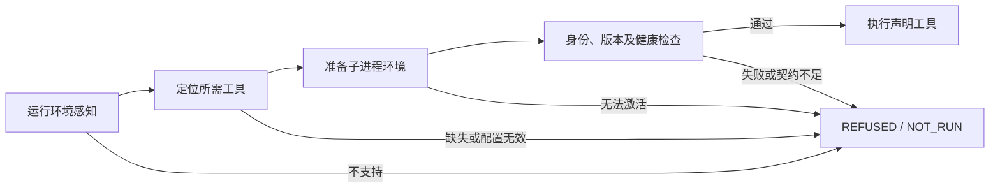

# EnvFeel：先感知，再执行

EnvFeel把环境发现与执行门禁连接起来。依赖由当前任务声明，不能因为系统缺少无关工具而拒绝整个任务，也不能把盘点清单中的“存在”直接当作执行许可。



## 门禁契约

感知使用运行时报告的OS、架构和进程位数，不用OS环境变量冒充实际平台。当前规则覆盖Windows、Linux、Darwin与已列出的x86/x86_64/arm64名称；未知组合拒绝。真实跨平台运行仍需分别实测，规则存在不代表这些平台已验收。Python引导运行时本身必须已可执行；本模块不能在完全无法启动Python的OS上自举，也不是硬件身份认证。

Windows架构现在使用原生IsWow64Process2查询，不使用WMI失败后的PROCESSOR_*环境回退。接口不可用或查询失败就拒绝，未给旧Windows添加猜测式回退；接口要求见[Microsoft说明](https://learn.microsoft.com/windows/win32/api/wow64apiset/nf-wow64apiset-iswow64process2)。Unix路径使用uname。Windows环境映射按键名大小写不敏感解析，冲突值拒绝。

定位优先使用明确参数，再进程环境、指定环境文件和PATH/SDK位置。无效覆盖不得回退。所需路径固定为绝对路径，原始位置只写私有清单。

激活仅构造当前调用的子进程环境：设置选中工具对应DSHA_*、前置工具目录至PATH，必要时设置JAVA_HOME与UTF-8输出。发现、自检及执行使用同一份环境；不改系统或用户环境、不修改注册表、不下载安装工具。环境文件不会执行或插值。

HOME缺失时仅跳过依赖用户目录的候选，不阻断引导Python和明确SDK根，也不从父进程借用被省略的HOME。缺少Windows机器目录时可只读查询本机登记的ProgramFiles/ProgramData，受限展开已知SystemDrive字段；不展开任意命令。Rust MSVC目标及直接声明cl均须定位并在子进程中初始化Windows SDK/VC链接环境，再做健康检查。初始化只加载所需核心SDK和VC脚本，合并PATH/INCLUDE/LIB等允许变量；不加载无关VS扩展，不改系统配置。分阶段初始化时须将VC脚本的延迟头文件路径合并到SDK路径之前并去重；检查excpt.h、vcruntime.h及windows.h可通过最终INCLUDE找到，失败不发布部分环境。cl健康样本实际包含Windows SDK和MSVC头文件，再检查生成COFF对象；链接运行仍须独立任务验证。见[MSVC头文件路径事故](ENVFEEL_MSVC_INCLUDE_2026-10-19.md)。

执行前检查工具品牌、版本及已定义健康样本。Python/Node执行、Rust/Java编译运行、MSVC对象编译、PowerShell/Bash/Sh标记输出分别有自有样本。其他具备品牌版本契约的条目只证明该探测可运行，不证明项目、网络、服务端或账号已可用。仅有数字版本而没有充分身份契约的条目返回INSUFFICIENT_CONTRACT；盘点可记录，门禁不能据此放行。

健康输出采用每次随机挑战及计算结果，拒绝只回显固定版本/固定标记的伪装程序；MSVC还检查生成对象的基本COFF结构。这是行为一致性检查，不是签名信任或完整工具身份认证，不能排除会模拟协议的恶意程序。极端工况前后对照见ENVFEEL_EXTREME_2026-10-19.md。

未拒绝的调用每次execute重新检查。READY只表示本轮声明条件通过，不是可重放的通行证；检查失败时任务为NOT_RUN，退出126。同一门禁对象一旦拒绝即停止，不再探测或重试；用户明确要求新执行时创建新的调用。任务自身失败则TASK_FAILED，不能伪报环境检查失败或任务成功。超时不是外部后代或远程操作已停止的证明。

## 拒绝即结束

拒绝或已知条件足以拒绝时，当前任务结束。返回stop=true、明确状态以及user_response：简短道歉、真实失败／未确认条件、合理检查去处、手动参数／环境配置方法、automatic_actions=[]。未知契约不能说成没安装，后续没检查的依赖标NOT_RUN；已运行的步骤如实列出，不把探测代码运行说成什么都没执行。明确未启动后续任务，不承诺已停止未知外部后代。

首个工具定位、版本、健康或项目能力失败后停止；已知项目根无效或执行工具未声明时，连工具探测也不开始。BaseTool先查授权，拒绝后不探测环境；其缺依赖和健康检查同样首项失败即结束。参数、来源清单和启动器错误也给相同停止指引。中文指导以可移植JSON转义传输，避免宿主默认编码损坏提示。

模型按技能中的停止规则给出用户可读回复后结束当前任务，不自动安装／升级／改环境／切工具／降要求／提权／重算锁或重试。旧的广泛授权不作为拒绝后的自行修复许可；等待用户新的明确要求。指引只是文字，不是可执行修复计划。仅允许原有自有资源收尾和显式请求的回执落盘；它们不授权后续修复。本规则不改变其他聊天，也不是全局模型或系统硬中断。授权的故障注入套件只结束每个被测调用，按既定计划继续独立用例；不能借此继续真实被拒绝的任务。

## 使用

```text
python <skill-dir>/scripts/dsha.py envfeel --require python
python <skill-dir>/scripts/dsha.py envfeel --require node --binary node=<executable> --env-file <private.env> --run node -- -e "console.log('ready')"
python scripts/envfeel.py --require python --private-output <new-run.local.json> --run python -- -c "print('ready')"
```

--require可重复；--run只能执行已声明工具，不由自然语言猜测命令。Java自动增加javac，javac增加java，Cargo增加rustc。额外工具也须显式声明后才能作为--binary覆盖。私有结果文件只接受新的*.local.json，保存位置和实际任务输出；公开摘要不输出任务stdout/stderr、真实路径或凭据。环境文件语法与允许键见ENVIRONMENT_CONFIGURATION.md。

## 接入范围

Codex适配器执行动作先检查Python运行时，REA CLI还检查Node，随后用同一准备环境调用。status和verify-source是只读元数据检查，envfeel入口自行执行完整链路。

BaseTool执行管道保留原权限、最低版本及目标边界校验，并新增运行环境感知、子环境激活、实际版本启动与已定义健康样本；没有最低版本的依赖也不再只看文件存在。Windows启动器在非Windows平台没有适配规则时拒绝。

直接调用第三方工具、外部MCP注册、原生客户端和绕开适配器的旧启动路径不因此自动受控。EnvFeel是环境门禁，不是权限沙箱，不授予额外执行授权。未知工具需要先声明和验证探测契约，而非自动下载或猜测运行方式。

实现：scripts/envfeel.py，安装闭包包含envfeel.py、environment_smoke.py、dsha_env.py，以及项目探测使用的project_probe.py和frontend_probe.cjs。受控失败与真实冒烟证据见ENVFEEL_REVIEW_2026-10-19.md。

## 项目能力：让实际环境回应

`--require typescript|react|vue`是项目能力，不是伪造一个同名可执行文件。自动加入Node需求；必须通过`--project <绝对目录>`或`DSHA_PROJECT_ROOT`指定含package.json的项目，参数优先，无效参数不回退。显式环境文件也允许DSHA_PROJECT_ROOT，不读取包管理器的全局安装声明。不支持tsc别名或任意自定义包名；普通Node任务仍只检查Node，不能把它的READY称为框架就绪。

```text
python <skill-dir>/scripts/dsha.py envfeel --require typescript --require react --require vue --project <absolute-project> --run node -- <owned-script>
```

先做Node身份／健康检查，再使用项目上下文实际解析和加载所需库。解析结果必须位于所选项目的真实目录内；祖先node_modules、项目外symlink、全局包不算此项目证据。工作区集中提升依赖时显式选定拥有这些依赖的工作区根；目前不支持项目外链接、PnP、纯ESM专用库或全局tsc。不会自动安装、调用npm脚本或读取tsconfig插件。前端探测及后续任务子环境移除NODE_OPTIONS和NODE_PATH，不修改父环境。

每次调用生成新的随机挑战及算术输入：

- TypeScript 5/6：真实Compiler API对自有严格类型程序编译，要求有输出；对错误赋值必须给2322诊断并拒绝输出；运行生成的JavaScript核对算术结果。它不等于完整项目typecheck；7及以后没有此契约，明确拒绝。
- React 18/19：检查React与react-dom版本一致，真实createElement及renderToStaticMarkup返回包含新挑战结果的HTML。只证明该SSR样本，不证明浏览器交互或生产构建。
- Vue 3：检查Vue和其实际@vue/server-renderer依赖身份／版本，要求reactive/computed更新以及SSR HTML均正确。Vue的server-renderer包装入口不能直接冒充实际renderer包身份；初版因此出现的误拒绝已保留并修正。

无包、只有依赖声明、版本号空壳、固定旧标记、错误响应或探测超时均拒绝，后续任务NOT_RUN。每能力探测上限20秒；超时不证明库自行派生的外部进程已停止。报告只公开状态、版本与检查范围，入口文件／清单哈希和位置在独占创建的私有*.local.json中。执行前重新检查，成功后在同一项目根和准备环境运行声明工具。项目依赖代码会在探测中实际执行；这是行为检查，不是权限沙箱、签名认证、恶意包鉴别或完整依赖闭包审计。已选入口／清单探测前后哈希相同也不保证检查与执行之间文件不可变。

官方API依据：[TypeScript Compiler API](https://github.com/microsoft/TypeScript/wiki/Using-the-Compiler-API)、[React静态SSR](https://react.dev/reference/react-dom/server/renderToStaticMarkup)、[Vue SSR](https://vuejs.org/api/ssr.html#rendertostring)。实现为独立自有挑战程序，无复制上游实现。实际新旧测试及安装结果另记ENVFEEL_PROJECT_REPLY_2026-10-19.md。
