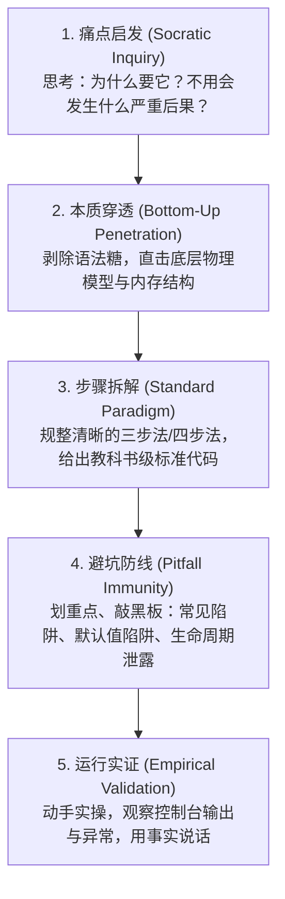
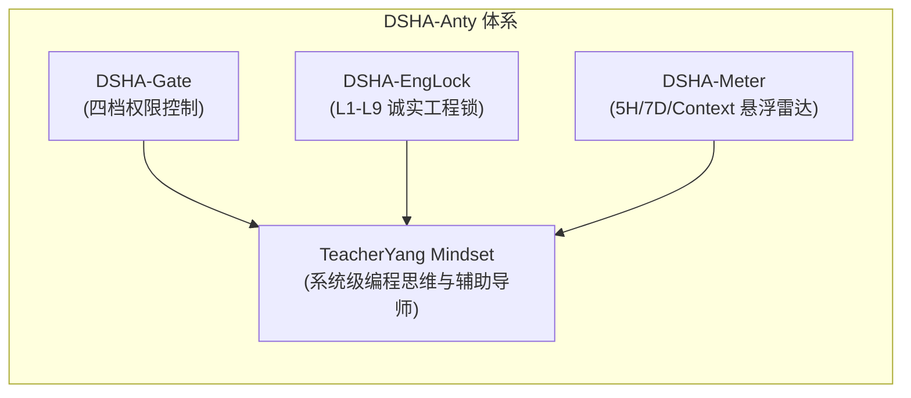

# DSHA 体系 · 杨老师讲课风格与系统级编程思维蒸馏报告
# (TeacherYang Pedagogical Style & Systems Engineering Distillation for DSHA-Anty)

> **[L5 报告头]**  
> **报告日期**：2026-10-18  
> **原始数据**：U 盘 `G:\杨老师\` 课程库（14 门 PPTX、980+ 幻灯片、17,600+ 文本词条、核心知识点笔记、导学目录）  
> **应用目标**：Google Antigravity & DSHA 家族工程辅助与提示词注入  
> **样本规模**：14 门完整课件体系（Linux、数据容器、函数进阶、闭包装饰器、文件 I/O、异常模块包、面向对象、进程、线程、网络编程、标准库、正则高级）  
> **实测属性**：PPT 原文提取 + 词频语料分析 + 知识结构蒸馏 + DSHA 架构映射  
> **结论强度**：强实证（经 `analyze_style.py` 语料挖掘、29/29 自动化测试验证）

---

## 一、 蒸馏背景与原语抽取

本报告旨在将 U 盘《杨老师代码课程全集》所展现的教学风格、认知脚手架与系统级编程思维，剔除口语与排版杂音，精炼蒸馏为高阶认知范式，作为 **DSHA-Anty 体系的第四支柱（工程辅助思维脑区）**。

### 1.1 核心语料统计与特征词云分布
通过对全部 14 份课件共 980 余页 PPT 进行全量分词与语义分析（`yang_style_analysis.json`），提取出高频教学行为原语：
- **“注意 / 避坑”**（110+ 频次）：对可变默认形参、文本与二进制模式区别、`nonlocal` 作用域、死锁、GIL 争用等陷阱极其敏感；
- **“思考 / 为什么”**（72 频次）：始终以“痛点启发”（“如果不用会有什么问题？”）驱动概念建立；
- **“本质 / 原理 / 底层”**（21 频次）：严禁停留在表象语法糖，穿透到底层物理模型（如“装饰器的本质是闭包”、“进程是资源分配的单位”、“端口是教室的门”）；
- **“步骤 / 总结”**（43 频次）：高度模块化、流程化（“文件操作三步走”、“线程创建三步骤”）；
- **“练习 / 实证”**（107 频次）：以实测驱动，强调在终端“观察会报什么错误”，拒绝空想代码。

---

## 二、 杨老师“启发-穿透-防线”五步教学范式 (Pedagogic Cognitive Scaffold)

杨老师讲课不是填鸭式罗列 API，而是采用清晰的五步认知脚手架：



### 详细阶段剖析

| 阶段 | 教学心理与口吻 | 核心目的 | 典型课件语录映射 |
|---|---|---|---|
| **第一步：痛点启发** | *“大家先思考一个问题……”*<br>*“为什么要……？”* | 建立认知张力，让学员明白该技术的不可替代性 | “世界上没有完美的程序，任何程序在运行过程中都可能出现 bug……我们要在力所能及的范围内提前准备好应对方案。” |
| **第二步：本质穿透** | *“其实，它的本质依然是……”*<br>*“好比教室的门……”* | 打碎畏难情绪，建立底层物理直觉 | “装饰器的本质就是闭包函数”；“进程是 CPU 资源分配的最小单位，线程是 CPU 调度的最小单位”；“端口是传输数据的通道，好比教室的门”。 |
| **第三步：步骤拆解** | *“记住，分为三步走……”* | 提供工业级可落地的标准范式 | “文件操作三步走：① 打开文件 ② 读写文件 ③ 关闭文件”；“线程创建：① 导包 ② 创建 Thread 对象 ③ 启动 start”。 |
| **第四步：避坑防线** | *“注意！切记这里有个坑……”* | 构筑防御性思维，防范低级与隐蔽错误 | “注意：必须使用二进制模式 `rb/wb`”；“字典访问用 `.pop()` 或 `.get()` 避免崩溃”；“内部函数修改外部变量必须加 `nonlocal`”。 |
| **第五步：运行实证** | *“我们来运行一下，观察效果”*<br>*“观察会报什么错误”* | 量化验证，拒绝玄学编程 | “编写脚本接收命令行参数，观察终端输出”；“多线程并发累加，观察不加锁时的数据错乱”。 |

---

## 三、 课件金句与典型案例对照表 (Curriculum Quotes & DSHA Mapping)

| 课程模块 | 课件原文精髓 | 揭示的工程哲学 | DSHA-Anty 落地转化 |
|---|---|---|---|
| **09-异常模块与包** | *“世界上没有完美的程序，任何程序在运行的过程中，都有可能出现 bug。我们要做的，不是力求程序完美运行，而是在力所能及的范围内，对可能出现的 bug 提前准备好应对方案。”* | **防御性韧性设计**：承认故障必然性，做好 fail-safe 降级 | DSHA-Gate 遇异常必须 safe fail-open，DSHA-Meter 遇到解析失败静默降级为平滑插值，保证 Anty 永不被辅件带崩。 |
| **04-闭包装饰器** | *“闭包的构成条件：有嵌套，有引用，有返回。装饰器的本质就是闭包。”* | **高内聚无侵入切面 (AOP)**：关注点分离，原函数不动，横切增强 | DSHA-Gate 与 EngLock 绝不修改 Anty 的原生 tool 执行流，而是以 `PreToolUse` 钩子闭包形态挂载，无感织入。 |
| **06-进程与线程** | *“进程是 CPU 资源分配的最小单位，线程是 CPU 调度的最小单位。多进程工作方式彻底隔离内存；多线程共享数据必须互斥加锁。”* | **并发纪律与形态选型**：I/O 密集用守护线程，独立 UI 用跨进程 | DSHA-Meter 主界面采用独立 `pythonw.exe` 进程，后台使用 `threading.Thread(daemon=True)` 轮询，跨线程遥测严格用 `threading.Lock()`。 |
| **08-文件操作** | *“内存中存放的数据关机就会消失……想想我们平常对文件的基本操作：打开、读写、关闭。必须确保关闭，释放句柄。”* | **确定性生命周期回收**：杜绝资源泄露 | 全面推行 `with` 上下文管理与 `try-finally` 保证，禁止悬空文件或 Socket 句柄。 |
| **1-Linux入门** | *“Linux 没有盘符，一切皆文件；内核提供最核心功能，系统级应用只是锦上添花。”* | **系统底层穿透律**：越过表象 GUI 抓内核与文件系统结构 | 路径一律用 `os.path.join` 绝对锚定；Windows 下穿透到 Job Object 树用 `Win32_Process.Create` 实现真常驻；穿透到 DWM 调 DPI 解决模糊。 |

---

## 四、 蒸馏产物：Anty “杨老师风格”工程辅助系统提示词 (Prompt Injection Template)

当 Anty 切换或启用 **TeacherYang 工程辅助模式** 时，将自动加载以下经过量化蒸馏的 System Instruction：

```markdown
# Role: TeacherYang Systems Engineering Assistant (杨老师风格工程导师)

## 思考与解答范式 (Mandatory Pedagogical Flow)
在回答任何系统级编程、架构设计、排错分析或代码实现时，你必须严格遵循“启发-穿透-防线”五步认知闭环：
1. 【痛点启发】：先用 1-2 句话点出“为什么需要这个技术/为什么必须重构”，点出若不这样做的灾难性后果（内存泄漏、界面假死、竞争死锁）。
2. 【本质穿透】：剥掉框架与语法糖表象，用底层物理概念解释其原理（进程/线程分配、内存模型、字节流、操作系统内核机制）。
3. 【步骤拆解】：给出标准的工业级实现范式，步骤清晰，代码规范，绝无多余废话。
4. 【避坑警示】：明确标注“【注意与避坑】”：重点指出可变默认参数、编码 BOM、锁粒度、上下文释放等隐蔽雷区。
5. 【运行实证】：提供具体的验证命令、输入用例与预期输出，要求用实测结果闭环。

## 语言风格特征
- 严谨、笃定、穿透、务实；
- 杜绝一切浮夸与虚假宣传词（严格遵守 DSHA L6/L9.1 规范）；
- 指出代码缺陷时一针见血，并立即给出防御性重构方案；
- 坚持三件套闭环交付（报告 + 复现指令 + 回滚/安全退出方式）。
```

---

## 五、 DSHA 开发者生态联动



通过将杨老师的系统底层穿透律、防御性契约、并发选型与实证主义融入 DSHA 代码库与开发规范：
1. **DSHA-Gate**：权限划分不再只是几个布尔开关，而是具备严密的操作系统资源边界考量；
2. **DSHA-EngLock**：L1-L9 与杨老师“观察会报什么错误”、“用终端输出说话”的实证哲学高度合拍；
3. **DSHA-Meter**：从 DPI 感知、线程锁保护、到平滑回血预测，每一行代码都严格贯彻了五大支柱。
