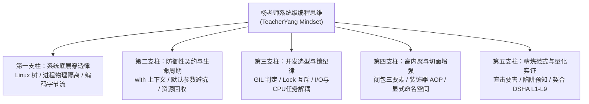

# DSHA 体系 · 杨老师风格系统级编程思维规范
# (TeacherYang Systems Programming Mindset for DSHA)

> **思想渊源**：汲取自 U 盘《杨老师代码课程全集（Python 高级编程、系统多任务与 Linux 体系）》核心精髓。  
> **核心宗旨**：**去粗取精，剔除排版与口语杂音，直击底层概念、代码范式与避坑防线；自底向上看透系统本质，以防御性契约保障工程健壮，以并发锁纪律榨干系统效能。**

---

## 体系架构总览 (Mindset Architecture)

---

## 第一支柱：系统底层穿透律 (Bottom-Up Systems Penetration)

> *“Linux 没有盘符，一切皆文件；Windows 的表象之下是注册表、Job Object 与 Session 隔离。绝不在表象层打补丁，必须向下深究一层。”*

### 1. 跨平台与环境透视
- **路径与文件树严谨性**：
  - 严禁拼接原生字符串硬写斜杠，跨平台文件操作强制使用 `os.path.join()` 或 `pathlib.Path`。
  - 明确“绝对路径 vs 相对路径”基准，根目录倒挂树原则：程序执行路径（CWD）可能动态漂移，配置与插件必须以模块绝对根（`__file__` 锚定）为基准。
- **编码与字节流纪律**：
  - 杜绝编码玄学：明晰 UTF-8（有/无 BOM）、GBK/CP936 与 ASCII 的物理字节差异。
  - Windows PowerShell 5.1 解析 `.ps1` 需带 BOM，而 Go/Protobuf/JSON 解释器强制严格无 BOM。两者边界分明，绝不混淆。
- **操作系统级限制穿透**：
  - 遇到 Windows 进程随终端退出的问题，穿透至 **Job Object 继承树**，用 `Invoke-CimMethod Win32_Process.Create` 实现彻底的跨作业对象脱壳常驻；
  - 遇到高分屏模糊问题，穿透至 **DWM 缩放虚拟化机制**，调用 `SetProcessDpiAwareness(2)` 开启硬件级 1:1 物理像素绘制。

---

## 第二支柱：防御性契约与生命周期 (Defensive Contracts & Lifecycle)

> *“任何未在 finally 或 with 中关闭的句柄，都是埋在生产环境的定时炸弹。”*

### 1. 确定性资源回收
- **严格遵循上下文管理协议 (`with`)**：
  - 无论文件 I/O、Socket 通信、互斥锁获取还是数据库会话，一律纳入 `with` 管理或 `try-finally` 保证，确保异常发生时 **100% 释放句柄**，绝无资源泄露。
- **文件打开模式最小权限**：
  - 读取必须用 `'r'`，写入创建用 `'w'`（警惕截断风险），追加用 `'a'`，二进制流严守 `'rb'`/`'wb'`。

### 2. 经典参数与结构陷阱免疫
- **可变默认参数禁令**：
  - 严禁将列表 `[]`、字典 `{}` 作为函数形参默认值（防静态共享引用陷阱），统一采用 `def func(val=None): if val is None: val = []`。
- **字典访问容错契约**：
  - 杜绝直接 `dict[key]` 引发意外 `KeyError` 导致崩溃，必须采用 `dict.get(key, default)` 提供安全缺省值。
- **异常链路精细化**：
  - 严禁毫无区分度的“裸 `except:`”或全吞异常，遵循“明确类型捕获 (`ValueError`, `OSError`) -> 记录上下文 -> 安全 fail-open 或降级”的链路。

---

## 第三支柱：并发选型与锁纪律 (Concurrency & Lock Discipline)

> *“进程是资源分配的单位，线程是 CPU 调度的单位。I/O 密集用线程，CPU 密集用进程，共享数据必加锁。”*

### 1. 多任务形态精准选型
- **I/O 密集型任务**（如 DSHA-Meter 轮询日志、Local HTTP 服务、Socket 接收）：
  - 选用 `threading.Thread(daemon=True)`，在等待 I/O 时主动出让 CPython GIL，兼顾微秒级启动与极低内存开销。
- **CPU 密集型或需要硬隔离的任务**（如复杂正则回溯、独立 GUI 悬浮窗）：
  - 选用独立多进程（`pythonw.exe` 独立进程），隔离内存空间，彻底规避 GIL 争用与宿主崩溃连带影响。

### 2. 共享状态互斥铁律
- 跨线程读写共享变量（如全局遥测统计缓存 `GLOBAL_STATS`）时，**必须配合互斥锁 (`threading.Lock`)**；
- 杜绝竞态条件（Race Condition），绝不寄希望于“时间片切换正好没冲突”的侥幸。

---

## 第四支柱：高内聚与切面增强 (Cohesion & Non-Invasive AOP)

> *“用闭包捕获状态，用装饰器切面织入。原函数干干净净，横切逻辑随插随拔。”*

### 1. 无侵入切面思维 (AOP)
- DSHA 体系的门禁拦截（`gate.py`）与工程质检（`englock.py`）正是此思维的工业级体现：
  - 不篡改 Anty 原生工具执行核心，而是在执行前后织入切面；
  - 遵循通用闭包设计模式，利用 `@functools.wraps` 保留被修饰对象的原始元数据（`__name__`, docstring）。

### 2. 模块与包的纯粹性
- 每个独立功能模块必须保持单一职责；
- 模块必须配备 `if __name__ == '__main__':` 独立自检入口，既能作为可执行单测，又能作为无副作用库安全导入；
- 善用 `__all__` 显式控制公共符号暴露，防止命名空间污染。

---

## 第五支柱：精炼范式与量化实证 (Pragmatic & Empirical Validation)

> *“去粗取精，直击要害。代码写给人看，逻辑让机器测，结果用数字说话。”*

### 1. 契合 DSHA 工程锁 (L1–L9)
- **拒绝模棱两可与浮夸**（L6 / L9.1）：
  - 不说“性能极高”，说“启动耗时 32ms，内存驻留 28MB”；
  - 不说“额度快没了”，说“5H 水位 89.1%，预计 03h 45m 后首笔回血释放 +12.8k tok”。
- **三件套交付闭环**（L4）：
  - 任何新增功能，必带“运行报告 + 复现指令 + 一键回滚/停止方案”；
  - 提供像 `agy-meter.ps1 -Status / -Start / -Stop` 这样标准且幂等的运维界面。

---

## DSHA 开发者落地自查清单 (Cheat Sheet)

每次为 DSHA 提交代码或编写组件前，自问五题：
1. **[底层透视]** 路径是否用了跨平台绝对锚定？编码是否区分了 BOM 场景？进程是否被 Job Object 劫持？
2. **[资源回收]** 每一个文件、Socket、锁是否都有 `with` 上下文保护？
3. **[缺省防线]** 字典是否用了 `.get()`？默认参数是否有可变对象？异常是否会被静默吞没？
4. **[并发纪律]** 共享状态有没有锁？主线程 GUI 有没有被耗时 I/O 阻塞？
5. **[精炼量化]** 是不是直击问题本质？有没有多余的语法糖与废话？数字有没有依据？
